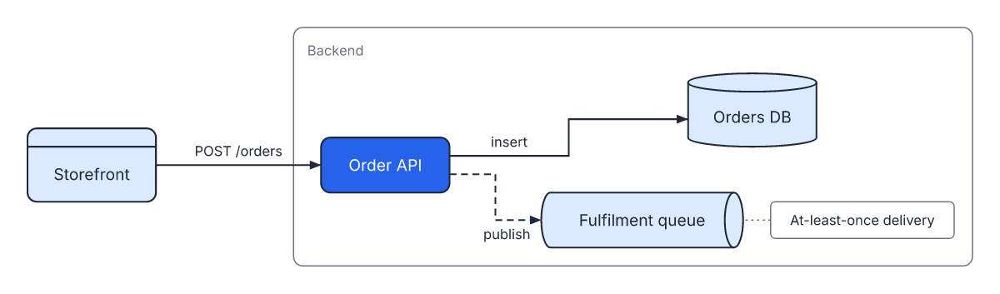

# Experiment: learning svgdog from its CLI output alone

*Date: 2026-11-14 · Binary: `target/release/svgdog` 1.0.4*

## Goal

Find out whether a newcomer can make a first diagram with svgdog using nothing but the command's
own output: help text, error messages, bundled examples and schemas. No source code, README or
GitBook pages were read. Along the way, record every point where I got stuck and what would have
saved time.

## Method

1. Run the binary with no arguments, then with `--help`.
2. Read the `--help` of the commands that looked like the entry point (`render`, `examples`,
   `schema`, `describe`).
3. List and print the bundled examples, then render one, preview it as PNG and look at the result.
4. Write a new spec by hand with deliberate mistakes (a typo in a node kind, an unknown field, a
   wrong arrow, an undeclared node) and fix them one by one using only the error messages.
5. Try the secondary commands: `describe`, `inspect`, `validate`, `edit`, `docs`.

All work happened in a scratch folder; no project files were touched.

## Outcome

**It worked.** A correct, good-looking diagram was ready about five commands after first contact,
and a hand-written spec rendered after four fix-and-retry rounds. The error messages are the best
part of the tool: each one names the bad value, lists the allowed ones and often suggests a fix
("Did you mean 'client'?"). The rough edges are in *discovery*: what the spec can contain, how
to see the validation report and what some commands do to your files.



*The bundled `flow` example after `render` + `preview`: a client, a highlighted service, a group,
a dashed async edge and a note. No warnings from the checks.*

## Your first diagram in five steps

This is the route that worked, written as an instruction for the next newcomer.

### 1. See which kinds of diagram exist

```sh
svgdog examples --format text
```

There are nine examples: `minimal`, `flow`, `layers`, `sequence`, `free`, `state`, `timeline`,
`compare` and `steps`. Start with `minimal` (edges only) or `flow` (all the common features).

### 2. Copy an example into a file

```sh
svgdog examples flow --format text > fig/first.yaml
```

Keep `--format text`. Without it, the output turns into JSON as soon as it is redirected.

### 3. Edit the spec

```yaml
version: 1                 # required
diagram: flow              # flow | layers | sequence | free | state | timeline | compare
title: Login               # required, used as <title> and in alt text
description: How a user signs in.   # optional, becomes <desc>
direction: down            # right (default) | down
nodes:                     # optional: an id that only appears in edges becomes a plain box
  - { id: user, label: User, kind: actor }
  - { id: app,  label: Mobile app, kind: client }
  - { id: auth, label: Auth service, kind: service, emphasis: true }
groups:
  - { id: backend, label: Backend, members: [auth] }
edges:
  - "user -> app: taps Login"        # solid
  - "app -> auth: POST /token"
  - "auth --> audit: log"            # dashed (asynchronous)
notes:
  - { attach: auth, text: Tokens expire after 1 h }
```

Quick reference (collected from error messages):

| What | Allowed values |
|---|---|
| `kind` | box, service, client, datastore, queue, actor, external, decision, document, state, start, end |
| arrows | `->`, `-->`, `..>`, `<->`, `<-->`, `--` (spaces around the arrow are required) |
| edge form | `"from -> to: label"` |

### 4. Render

```sh
svgdog render fig/first.yaml -o fig/first.svg
```

The report ends with `1 file checked: 0 errors, 0 warnings…`. To render again into the same file,
add `--previous fig/first.svg` (keeps the boxes where they were) or `--force` (fresh layout).

### 5. Look at it

```sh
svgdog preview fig/first.svg -o fig/first.png      # PNG to open
svgdog describe fig/first.yaml --format text       # the diagram in words
svgdog describe fig/first.yaml --short             # one-line alt text
```

**Bonus: diagrams inside Markdown.** Put the spec in a ` ```svgdog ` code fence and run
`svgdog docs page.md`. It writes `diagrams/page-1.svg` and adds an image link with alt text
below the fence. Note that this changes `page.md` itself.

## Where I got lost, and what would have helped

Ranked by time lost.

| # | Situation | What happened | Suggestion |
|---|---|---|---|
| 1 | Fixing a hand-written spec | Errors arrive **one per run**: `version` missing, then `title`, then the bad kind, then the unknown field, then the bad arrow. My spec with three mistakes took four runs. | Report all spec errors in one pass, as `validate` already does for SVG. |
| 2 | Wanting to know what a spec may contain | Node kinds, arrows and fields can only be found by triggering errors or by reading a long JSON Schema. `render --help` says nothing about the spec format. | A short `svgdog spec` / `schema spec --format text` cheat sheet: fields, kinds, arrows, one line each. Mention it in `render --help`. |
| 3 | Seeing the check results without writing a file | `render -o -` prints only the SVG, so the report is lost. `-o /dev/null` fails with "already exists". `validate` takes only SVG. | A `render --dry-run` (or `--check-spec`) that validates and prints the report without writing; let `-o -` send the report to stderr. |
| 4 | Feeding a YAML spec to `validate` | Answer: "The file is not well-formed XML: unknown token at 1:1." | Recognise a spec and say "this is a diagram spec; use `svgdog render`". |
| 5 | Running with no arguments in a script | The output is a JSON error, not the usage text, because stdout is not a terminal. | Print the short usage on stderr too, or at least keep the hint to `--help`. |
| 6 | Redirecting an example to a file | `examples flow > first.yaml` without `--format text` writes JSON, which then fails to render as a spec. The help example has the flag, but it is easy to miss. | When printing a single example, always print the YAML; keep JSON only for the list. |
| 7 | Colouring a node | `color: red` gives "Unknown field 'color'" with no hint. I guessed from the example that `emphasis: true` is the only styling. | Add a hint: "Nodes are styled by `kind` and `emphasis`; colours come from the theme." |
| 8 | `docs` command | `docs --help` does not show the fence name (`svgdog`), and it does not say the Markdown file gets rewritten. I guessed the fence. | One example fence in the help, plus "adds or updates the image link under each fence". |
| 9 | `schema spec --format text` | Still prints raw JSON. | Either a readable text form or drop `text` from the choices. |
| 10 | `title` vs `description` | `title` is required, `description` is not, yet every example has both and both end up in the SVG. | Warn (info level) when `description` is missing, since it feeds accessibility. |

### What already works well

- Error messages name the field, the bad value and the allowed values, and suggest the closest
  match (`clinet` → `client`, `databse` → `database`).
- A typo in a node id inside an edge is caught instead of silently creating a new box.
- `output-exists` explains both ways forward (`--previous`, `--force`).
- `examples` is the right first door: each one is short, commented and renders cleanly.
- `describe --short` gives ready alt text, and `docs` puts it into the Markdown automatically.

## Conclusion

A newcomer can make a first diagram from the CLI alone in a few minutes, mainly thanks to the
examples and the clear error messages. The quickest wins would be reporting all spec errors at
once (#1), a readable spec cheat sheet linked from `render --help` (#2), and a way to see the
check report without writing a file (#3). Together they would remove most of the trial-and-error
rounds seen in this experiment.
